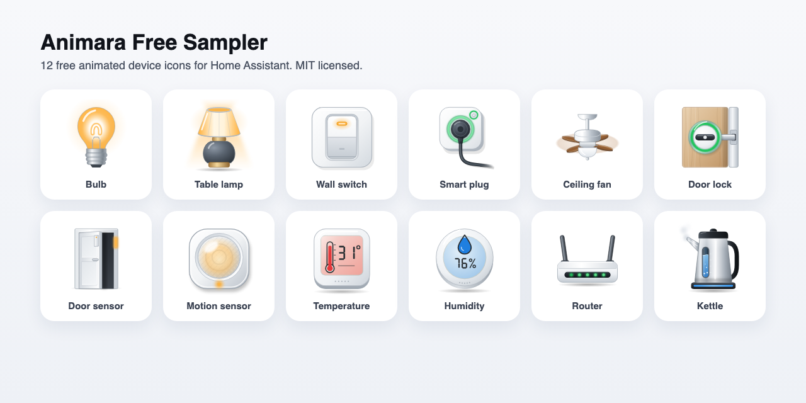

# Animara Free Sampler

12 realistic, animated device icons for Home Assistant dashboards. Each icon shows what the device is really doing: the bulb glows, the fan spins, the kettle boils, the door sensor opens. Free and open source (MIT).



## What's inside

Bulb, table lamp, wall switch, smart plug, ceiling fan, door lock, door sensor, motion sensor, temperature sensor, humidity sensor, router and kettle, each with all of its real states, in light and dark themes.

The card picks the right icon and state from your entity automatically, and you set everything up with dropdowns.

## The easy way: one link (recommended)

We made this way especially for our users, so anyone can install it in a few minutes, with no files to copy.

1. In Home Assistant, open your user profile (bottom left) and turn on **Advanced mode**.
2. Go to **Settings, Dashboards**, open the three dot menu, choose **Resources**, then **Add resource**.
3. Paste `https://animara.io/ha/animara-free.js`, choose **JavaScript module**, then **Create**, and reload your browser.

Every screen keeps its own copy, so it keeps working when the internet is down. Step by step: [animara.io/install](https://animara.io/install/?utm_source=github&utm_medium=readme&utm_campaign=sampler-install).

## Install with HACS (or the Home Assistant Marketplace)

Animara Free Sampler is in the HACS default list. Open HACS (or the Marketplace in Home Assistant 2026.11), search **Animara Free Sampler**, download it, and reload your browser.

## Install by hand

1. Download `animara-sampler-card.js` from the latest release.
2. Copy it to `/config/www/` on your Home Assistant.
3. Go to **Settings, Dashboards**, open the three dot menu, choose **Resources**, and add `/local/animara-sampler-card.js` as a **JavaScript module**.
4. Reload your browser.

## Use it

Edit a dashboard, choose **Add card**, search for **Animara**, and pick your entity. Or in YAML:

```yaml
type: custom:animara-card
entity: light.living_room
icon: bulb
```

Layouts: `tile` (default), `rich` and `icon`.

## Want every device?

The full Animara pack has 307 animated devices with 808 real states: washing machines, air conditioners, hot tubs, espresso machines, speakers, solar, security and much more, plus standalone SVG files and an openHAB set. One payment, free updates, up to 3 homes.

There are also ready Home Assistant dashboards built on these icons, all of which build themselves from your rooms:

- **Animara Float**, a glass dashboard where every device floats above its own tile and lamps throw their real light. [Try it live](https://animara.io/?utm_source=github&utm_medium=readme&utm_campaign=sampler-float#try-float)
- **Animara Home**, a complete dashboard for phones, tablets and wall panels.
- **Animara Showroom**, your home on a wall screen, one device at a time.

See everything at [animara.io](https://animara.io/?utm_source=github&utm_medium=readme&utm_campaign=sampler-full).
