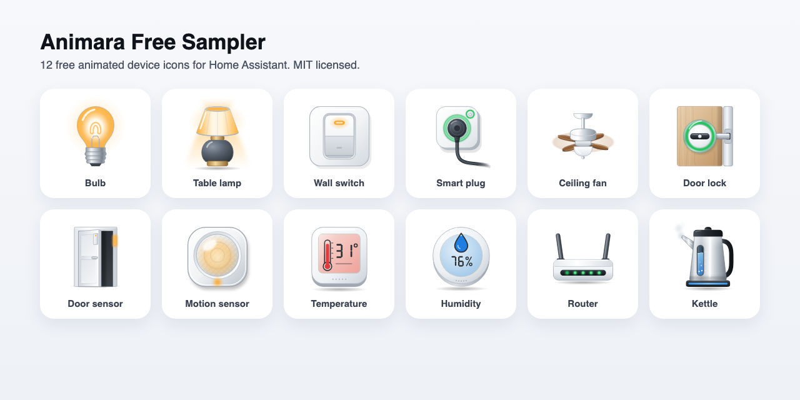

# Animara Free Sampler

12 realistic, animated device icons for Home Assistant dashboards. Each icon shows what the device is really doing: the bulb glows, the fan spins, the kettle boils, the door sensor opens. Free and open source (MIT).



## What's inside

Bulb, table lamp, wall switch, smart plug, ceiling fan, door lock, door sensor, motion sensor, temperature sensor, humidity sensor, router and kettle, each with all of its real states, in light and dark themes.

The card picks the right icon and state from your entity automatically, and you set everything up with dropdowns.

## Install with HACS

1. Open HACS, then the three dot menu, then **Custom repositories**.
2. Add `https://github.com/animaraicons/animara-free-sampler` with the type **Dashboard**.
3. Find **Animara Free Sampler** in HACS, download it, and reload your browser.

## Install by hand

1. Download `animara-sampler-card.js` from the latest release.
2. Copy it to `/config/www/` on your Home Assistant.
3. Go to **Settings, Dashboards**, open the three dot menu, choose **Resources**, and add `/local/animara-sampler-card.js` as a **JavaScript module**.
4. Reload your browser.

## Use it

Edit a dashboard, choose **Add card**, search for **Animara**, and pick your entity. Or in YAML:

```yaml
type: custom:animara-card
entity: light.living_room
icon: bulb
```

Layouts: `tile` (default), `rich` and `icon`.

## Want every device?

The full Animara pack has hundreds of animated devices: washing machines, air conditioners, hot tubs, espresso machines, speakers, solar, security and much more, plus standalone SVG files and an openHAB set. One payment, free updates, up to 3 homes.

**See them all at [animara.io](https://animara.io)**

## License

The 12 sampler icons and this card are MIT licensed (see LICENSE). The full Animara pack is sold separately under its own license at [animara.io](https://animara.io).

## Support

Questions or ideas? Write to animara.icons@gmail.com.
